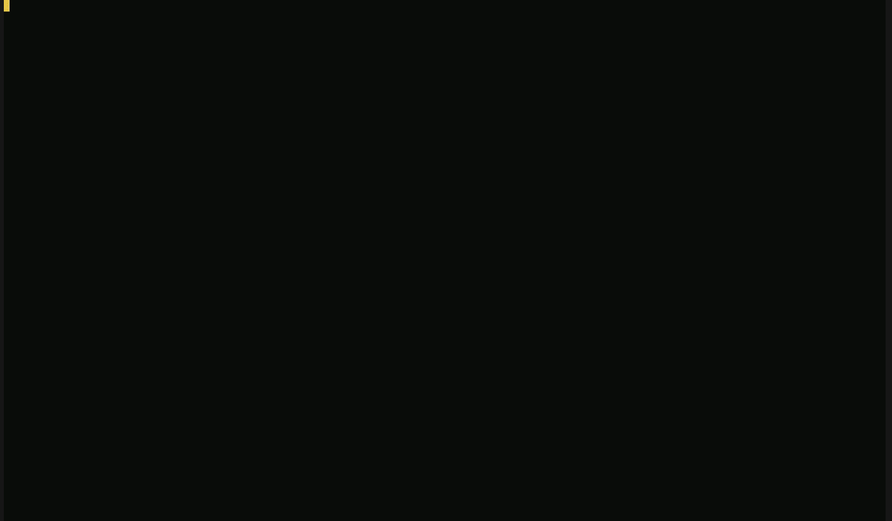
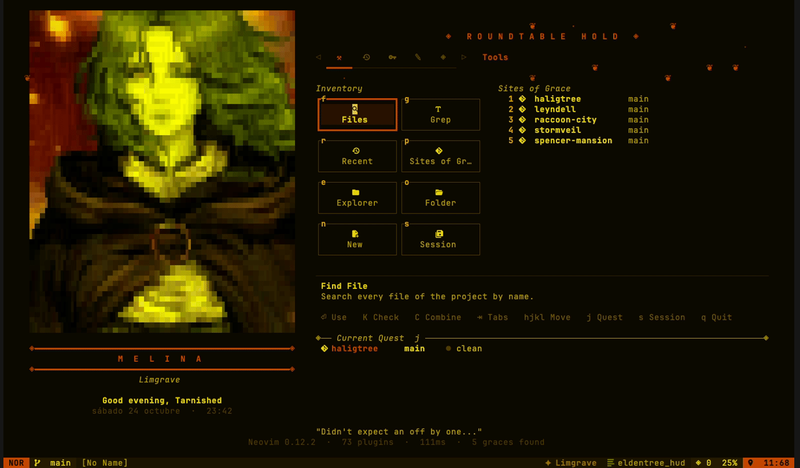
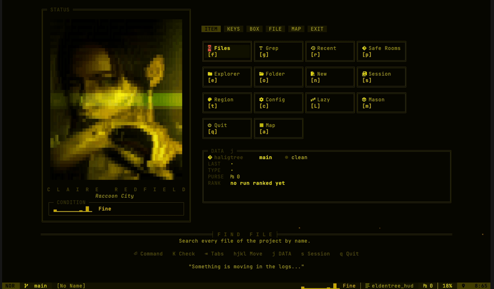
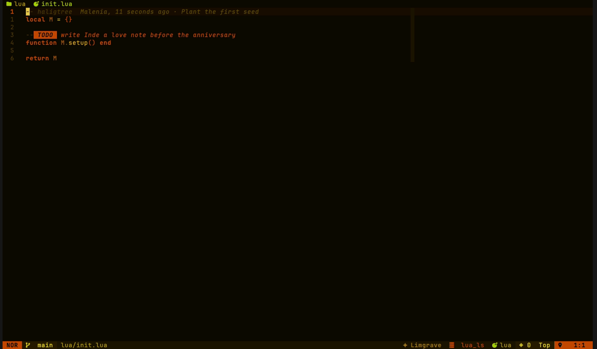
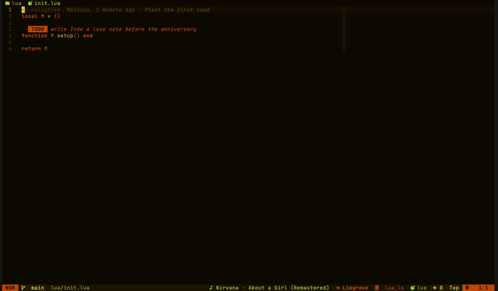
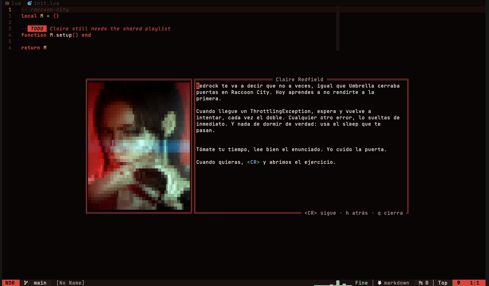
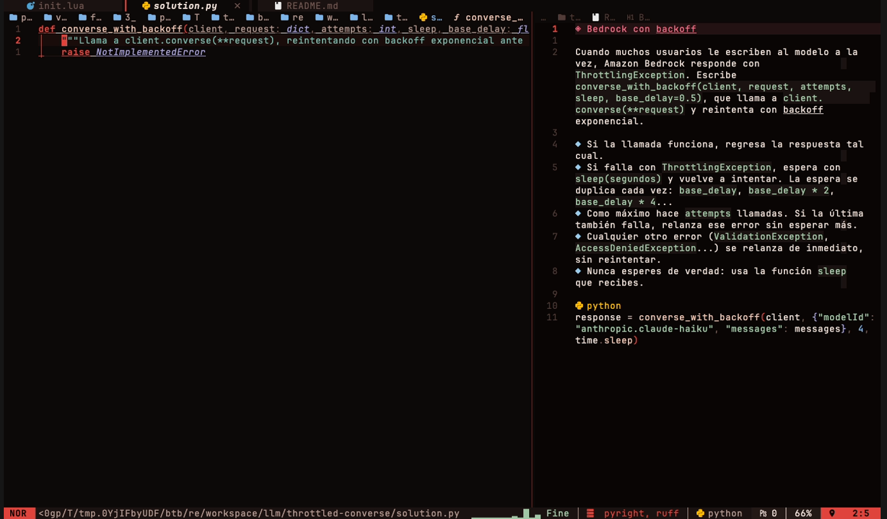
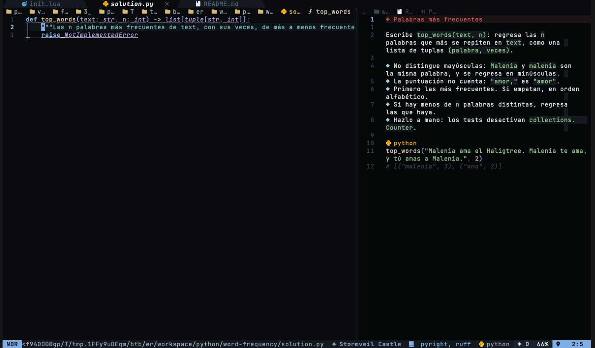

# Eldentree

[](https://github.com/thecristopher/nvim-config/actions/workflows/ci.yml)

A Neovim config forged in the Lands Between, or in Raccoon City depending on the day. Catppuccin Mocha, recolored for whichever region or location you wake up in, with banners, runes and a Site of Grace that lets you rest when you step away.

Runs on macOS, Linux and Windows, and also inside Cursor and VS Code.


## A look around

The title screen, once a day per franchise and on every switch.



The start screen is an inventory. Elden Ring opens the Roundtable Hold with its tabs, the item grid and your Sites of Grace.



On Resident Evil days it is the STATUS screen, with Claire, her DATA and the COMMAND menu.



Banners land on commits, PRs, test runs and felled bosses. When you die, the code crumbles into rain behind the banner and comes back as it fades.



And whatever Music.app or Cider is playing sits in the statusline, with the cover a keypress away.



Daily drills come from [back-to-basics](https://github.com/thecristopher/back-to-basics), coached by the franchise of the day. On Resident Evil days Claire briefs the exercise, a Bedrock one here, and every name and place in it stays in Raccoon City.



Then the fight opens by hand, with the statement beside it and completion off.



On Elden Ring days it is Malenia, and the exercises live in the Lands Between.




## Requirements

- Neovim 0.11 or newer (0.12 recommended)
- git
- A [Nerd Font](https://www.nerdfonts.com/) in your terminal
- The `tree-sitter` CLI, which builds the parsers
- Optional: `ripgrep` and `fd` for faster pickers, and `gh` for PR drafts
- Optional: a GitHub Copilot account for inline suggestions. Run `:Copilot auth` once, the first use downloads Copilot's language server

## Install

Back up any existing config first, then clone this repo where Neovim looks for its config.

```sh
# macOS and Linux
git clone https://github.com/thecristopher/nvim-config ~/.config/nvim
```

```powershell
# Windows
git clone https://github.com/thecristopher/nvim-config $env:LOCALAPPDATA\nvim
```

Launch `nvim` and lazy.nvim bootstraps itself and installs every plugin on the first run. Mason installs the language servers.

## Your own style guide

Claude follows one style guide in this config: `.claude/commands/my-style.md`. It is loaded into every Claude Code session opened here, it backs `/my-style`, and `<leader>pc` / `<leader>pp` send it to Claude when drafting commits and PRs.

It is Cristopher's guide, so replace that file with yours and everything follows it. To use it outside this repo too, link it as a global command:

```sh
ln -sf ~/.config/nvim/.claude/commands/my-style.md ~/.claude/commands/my-style.md
```

## What is inside

| Module           | What it does                                                                                                                                                                                                                                                                                                                                                                                                                                                                                                                                                                         |
| ---------------- | ------------------------------------------------------------------------------------------------------------------------------------------------------------------------------------------------------------------------------------------------------------------------------------------------------------------------------------------------------------------------------------------------------------------------------------------------------------------------------------------------------------------------------------------------------------------------------------ |
| `core/franchise` | Picks the world for the day, rotating between Elden Ring and Resident Evil. Its lore folders hold the palettes, bosses, weather, banners and words. `:Franchise` switches until midnight, `vim.g.eldentree_franchise` pins one. Each lore also picks its `mechanics`, so Resident Evil travels through doors, gets stalked instead of dueling, shows a health ECG, rests at a typewriter and ranks every run. Each lore folder is a pack (palettes, skin, words) found on its own, `:Franchise new Silent Hill` scaffolds one and `:checkhealth eldentree` lists what it still needs |
| `core/skin`      | Dresses components per franchise: float borders, gutter signs, statusline separators and tabs. Elden Ring is rounded and ornate, Resident Evil wears the inventory's double frames                                                                                                                                                                                                                                                                                                                                                                                                   |
| `core/hud`       | The start screen is a playable inventory. Elden Ring shows category tabs with the Inventory and the Chest side by side, Resident Evil a STATUS panel with the survivor, plate tabs          and the COMMAND menu. hjkl walks the slots, Tab changes category, Enter uses, K checks, C combines. `:Hud` or `<leader>uh` reopens it                                                                                                                                                                                                                                                    |
| `core/title`     | A title screen in big block letters once a day per franchise and on every switch, `:Title` shows it again                                                                                                                                                                                                                                                                                                                                                                                                                                                                            |
| `core/terminal`  | Paints the terminal around nvim with the region's background, and switches iTerm profiles, Kitty opacity or the Ghostty font and opacity per franchise. `:Opacity [90                                                                                                                                                                                                                                                                                                                                                                                                                | skin]`or`<leader>uo`picks your own opacity, kept until set back to`skin` |
| `core/sound`     | Plays your own sounds from `sounds/<franchise>/` for titles, doors, deaths and the merchant                                                                                                                                                                                                                                                                                                                                                                                                                                                                                          |
| `core/themes`    | Region palettes from the franchise in use (eleven in Elden Ring, seven in Resident Evil). One region per day, the same in every repo and every launch. Picking another with `<leader>ut` holds until midnight, and traveling between repos never changes it. Pin one with `vim.g.eldentree_region`                                                                                                                                                                                                                                                                                   |
| `core/phantom`   | `<leader>gw` shows who last wrote the line as a phantom: blue for others, gold for your past self                                                                                                                                                                                                                                                                                                                                                                                                                                                                                    |
| `core/music`     | The song playing in Cider (macOS, Windows, Linux) or Music.app (macOS) sits in the statusline. `<leader>o` or a click on it opens a now playing panel with the album cover, `p` plays or pauses, `n` and `b` skip. Cider needs its API on in Settings > Connectivity, and `vim.g.eldentree_cider_token` when it asks for a token. `vim.g.eldentree_music = false` turns it off                                                                                                                                                                                                       |
| `core/btb`       | Brings [back-to-basics](https://github.com/thecristopher/back-to-basics) in: daily drills by hand, coached by the franchise (Claire in Resident Evil, Malenia in Elden Ring) on a stage with their portrait. Clean solves fell the enemy, level ups bring the great banner, XP pays runes, and the lessons you fought fill the HUD. `b` on the HUD or `<leader>kk` starts the lesson. Needs the clone in `~/Documents/GitHub/back-to-basics` or `vim.g.eldentree_btb_dir`                                                                                                            |
| `core/zones`     | The first time you walk into a folder each session, it is announced like a new area of the Lands Between                                                                                                                                                                                                                                                                                                                                                                                                                                                                             |
| `core/snapshot`  | `<leader>cp` / `:Snapshot` saves the buffer or selection as a framed PNG in the region's colors and copies it                                                                                                                                                                                                                                                                                                                                                                                                                                                                        |
| `core/hub`       | The HUD's ambient life: shimmering gold, the region's weather and a typed player message                                                                                                                                                                                                                                                                                                                                                                                                                                                                                             |
| `core/banner`    | Elden Ring style banners fired by commits, PRs, test runs, new projects and region changes                                                                                                                                                                                                                                                                                                                                                                                                                                                                                           |
| `core/boss`      | When 3 or more errors linger, the region's boss arrives with a health bar. Each fix lands a hit, the last one fells it. In Resident Evil the boss is a stalker that walks closer while errors stay and backs off with every fix                                                                                                                                                                                                                                                                                                                                                      |
| `core/door`      | Resident Evil's travel: the screen goes dark and a door creaks open, where Elden Ring rolls the fog wall                                                                                                                                                                                                                                                                                                                                                                                                                                                                             |
| `core/ecg`       | Resident Evil's statusline ECG: Fine, Caution or Danger from the buffer's diagnostics                                                                                                                                                                                                                                                                                                                                                                                                                                                                                                |
| `core/map`       | `:Map` / `<leader>fM` shows every folder as a room, red while errors or TODOs are left in it, blue once cleared                                                                                                                                                                                                                                                                                                                                                                                                                                                                      |
| `core/results`   | Ranks each run from S to D by fixes and saves, and the Resident Evil STATUS panel shows the last one                                                                                                                                                                                                                                                                                                                                                                                                                                                                                 |
| `core/runes`     | Statusline rune tally (pesetas in Resident Evil, where the Merchant greets every 10,000). Saves and banners pay out, dying leaves a bloodstain                                                                                                                                                                                                                                                                                                                                                                                                                                       |
| `core/rest`      | After 5 idle minutes in normal mode the editor rests at a Site of Grace, or at a Safe Room typewriter in Resident Evil. Any key wakes it                                                                                                                                                                                                                                                                                                                                                                                                                                             |
| `core/repos`     | Background repo scanner, the Sites of Grace project picker and automatic project root                                                                                                                                                                                                                                                                                                                                                                                                                                                                                                |
| `core/dive`      | F12 family: go to definition, Glance peek, references and F2 rename                                                                                                                                                                                                                                                                                                                                                                                                                                                                                                                  |
| `core/trial`     | Runs the project's tests in the background and announces the verdict                                                                                                                                                                                                                                                                                                                                                                                                                                                                                                                 |
| `core/git`       | Quick branch, pull, push, sync, stash and undo shortcuts, plus the related change staging `<leader>pc` uses                                                                                                                                                                                                                                                                                                                                                                                                                                                                          |
| `core/motion`    | Shared animation engine. Ambient loops pause while Neovim is unfocused                                                                                                                                                                                                                                                                                                                                                                                                                                                                                                               |
| `core/vscode`    | Inside Cursor or VS Code, only the allow listed editing plugins load                                                                                                                                                                                                                                                                                                                                                                                                                                                                                                                 |

Plugin specs live in `lua/plugins/`, one file per concern.

Copilot suggestions come through blink as one more source, and the top item previews inline as ghost text. The quickfix list is editable with quicker.nvim (change a line, `:w` writes it back to the file), yanky.nvim keeps a yank history, and spell checks English and Spanish in markdown, commits and text.

A few classics from ThePrimeagen's setup live here too: cloak.nvim masks `.env` values so secrets never show on a shared screen or a snapshot, `<leader>rw` replaces the word under the cursor across the file, `<leader>cx` makes the file executable, `:VimBeGood` trains your motions, and `<leader>ur` makes it rain. Dying makes it rain on its own, `vim.g.eldentree_rain = false` keeps the code standing.

Traveling to a Site of Grace keeps the session of the repo you leave and restores the one you arrive at. Files with unsaved changes are never closed. Turn it off with `vim.g.eldentree_project_sessions = false`.

Portraits in `images/portraits/` are 276x336 crops of the originals in `images/`, with contrast, color and sharpness lifted so they survive half block rendering. A region whose portrait is missing simply shows the HUD without art.

### Terminals

Everything works in iTerm. Two extras are worth turning on:

- **Fonts per franchise in iTerm.** Link the profiles once, then add `vim.g.eldentree_iterm_profiles = true` to `lua/core/options.lua`. Elden Ring switches to JetBrains Mono Light with a light blur, Resident Evil to SemiBold with no transparency.

  ```sh
  ln -s ~/.config/nvim/terminal/iterm/Eldentree.json ~/Library/Application\ Support/iTerm2/DynamicProfiles/
  ```

- **Fonts per franchise in Ghostty.** nvim writes the franchise's font, opacity and blur to `~/.config/ghostty/eldentree` and asks Ghostty to reload it (macOS, through AppleScript). Include it once from your Ghostty config, the `?` keeps Ghostty quiet while the file does not exist yet. Reloading applies to every Ghostty window, and leaving the last nvim empties the file so Ghostty goes back to its own look, while other nvims still open keep it. `vim.g.eldentree_ghostty_config = false` turns it off.

  ```
  config-file = ?~/.config/ghostty/eldentree
  ```

- **Real image portraits.** Ghostty, Kitty and WezTerm speak the kitty graphics protocol, so the HUD shows the portraits as actual pictures instead of chafa's half blocks. The portraits are JPEG, so snacks needs ImageMagick to convert them (`brew install imagemagick`), without it they stay in chafa. Ghostty is the closest to iTerm in feel: `brew install --cask ghostty`.

### Sounds

Every sound is made from scratch by `python3 scripts/sounds.py`: synthesized tones and noise, spoken lines from [Piper](https://github.com/OHF-Voice/piper1-gpl) (a local neural voice) with macOS `say` as the fallback, and ffmpeg for the echo and pitch, nothing sampled from the games. Run `python3 scripts/sounds.py --setup-voices` once to install Piper and its voices in `~/.local/share/eldentree`. Run it again after tweaking a recipe, or pass a franchise to rebuild only that one. `:Sound died` previews any of them.

To use your own instead, drop audio files into `sounds/elden_ring/` or `sounds/resident_evil/`, named after the moment they belong to: `title`, `door`, `fog`, `rest`, `boss`, `merchant`, `felled`, `great`, `died`, `grace`, `cleansed`, `region`, `zone`, `phantom`, `continue`, and the inventory HUD's `hud_open`, `hud_close`, `hud_move`, `hud_select`, `hud_back`. Variants like `died_2.wav` take turns. Missing files stay quiet, `vim.g.eldentree_sound = false` silences everything.

### Voice credits

| Voice                          | Used for                              | Source                                                                          | License         |
| ------------------------------ | ------------------------------------- | ------------------------------------------------------------------------------- | --------------- |
| Ryan (high)                    | Resident Evil announcer               | [Piper voices](https://huggingface.co/rhasspy/piper-voices), RyanSpeech dataset | CC BY-NC-SA 4.0 |
| Northern English Male (medium) | The Merchant, the Elden Ring narrator | [Piper voices](https://huggingface.co/rhasspy/piper-voices)                     | CC BY-SA 4.0    |

### Portrait credits

The Resident Evil portraits are fan art and photography by their own authors, used here with love and full credit to them.

| Portrait | Region           | Author          |
| -------- | ---------------- | --------------- |
| Claire   | Raccoon City     | Artist pending  |
| Leon     | RPD              | Artist pending  |
| Jill     | Spencer Mansion  | Like Detectives |
| Wesker   | Umbrella Lab     | Artist pending  |
| Ashley   | Salazar Castle   | Artist pending  |
| Ada      | Saddler's Island | Artist pending  |
| Chris    | The Village      | Artist pending  |

## Keys

Leader is `<Space>`, local leader is `\`.

| Key                         | Action                                                                             |
| --------------------------- | ---------------------------------------------------------------------------------- |
| `<leader>fp`                | Find a project (Sites of Grace)                                                    |
| `<leader>ut`                | Choose a region theme                                                              |
| `<leader>uT`                | Next region theme                                                                  |
| `<leader>uf`                | Choose today's franchise                                                           |
| `<leader>uo`                | Choose the terminal opacity (Kitty, Ghostty)                                       |
| `<leader>uh`                | Open the inventory HUD                                                             |
| `<leader>fM`                | Project map                                                                        |
| `<leader>um`                | Toggle animations                                                                  |
| `<leader>cT`                | Run tests (Trial)                                                                  |
| `<leader>kk`                | Lesson with the coach (back-to-basics)                                             |
| `<leader>kb`                | Lesson library (back-to-basics)                                                    |
| `<leader>uB`                | Toggle boss fights                                                                 |
| `<leader>gw`                | Who wrote this line (phantom)                                                      |
| `<leader>cp`                | Snapshot the buffer or selection as a PNG                                          |
| `<leader>o`                 | Now playing panel with the album cover                                             |
| `<leader>to`                | Open the last link a terminal printed, like the dev server's localhost             |
| `<C-LeftMouse>`             | In a terminal, open the link under the mouse                                       |
| `<leader>xQ`                | Toggle the quickfix list, editable (quicker)                                       |
| `[y` / `]y`                 | Right after a paste, swap it for the older or newer yank                           |
| `<leader>fy`                | Yank history                                                                       |
| `<leader>rw`                | Replace the word under the cursor in this file (`<C-w>` clears the prefilled word) |
| `<leader>cx`                | Make this file executable                                                          |
| `<leader>uc` / `<leader>uC` | Toggle the `.env` cloak, or peek one line                                          |
| `<leader>ur`                | Make it rain                                                                       |
| `K`                         | Hover docs, dressed as an item description                                         |
| `<leader>fR`                | Find and replace in the project (grug-far), works on a selection too               |
| `<leader>fF`                | Find and replace in this file                                                      |
| `<C-n>`                     | Add a cursor on the next match (multicursor)                                       |
| `<A-Up>` / `<A-Down>`       | Add a cursor above or below                                                        |
| `<leader>Ma`                | Add a cursor on every match                                                        |
| `<leader>pc`                | Stage related changes and draft the commit with Claude                             |
| `<leader>gN`                | New branch (pick a prefix, type a name)                                            |
| `<leader>gj`                | Pull                                                                               |
| `<leader>gk`                | Push (sets upstream the first time, never forces)                                  |
| `<leader>gm`                | Merge the base branch into this one                                                |
| `<leader>gM`                | Switch to the base branch and pull                                                 |
| `<leader>ga`                | Stage related changes (skips .env, logs, swap files)                               |
| `<leader>gz`                | Stash everything, untracked included                                               |
| `<leader>gZ`                | Pop the latest stash                                                               |
| `<leader>gu`                | Undo the last unpushed commit, keep its changes staged                             |
| `<leader>gn`                | Neogit status                                                                      |
| `<leader>gc`                | Neogit commit                                                                      |
| `<leader>gp` / `<leader>gP` | Neogit pull / push popups                                                          |
| `<leader>gv`                | Neogit log                                                                         |
| `<leader>gr`                | Neogit branch popup                                                                |
| `<leader>gC`                | Search commits (Telescope)                                                         |

Inside a toggleterm terminal, the bar at the top lists the quick git keys. Press `<Esc>` and then `<Space>g` to use them.

While several cursors are active, `n` / `N` add the next or previous match, `q` / `Q` skip one, `<Left>` / `<Right>` switch the main cursor and `<Esc>` clears them.

| Key                         | Action                              |
| --------------------------- | ----------------------------------- |
| `<leader>Tt`                | Run the nearest test (neotest)      |
| `<leader>Tf`                | Run every test in this file         |
| `<leader>Td`                | Debug the nearest test              |
| `<leader>Ts`                | Test summary                        |
| `<leader>To`                | Output of the test under the cursor |
| `<leader>Tw`                | Rerun this file on every save       |
| `]T` / `[T`                 | Next or previous failed test        |
| `F5`                        | Start or continue debugging         |
| `Shift F5`                  | Stop debugging                      |
| `F9`                        | Toggle breakpoint                   |
| `F10` / `F11` / `Shift F11` | Step over, into, out                |

| `<leader>DB` | Conditional breakpoint |
| `<leader>Dp` | Log point |
| `<leader>Dv` | Toggle the debug view |
| `<leader>Dw` | Watch the expression under the cursor |

On macOS, F11 shows the desktop unless "Use F1, F2, etc. keys as standard function keys" is on. `<leader>Di` steps into without it.

| Key   | Action           |
| ----- | ---------------- |
| `F12` | Go to definition |
| `F2`  | Rename symbol    |

## Commands

| Command                                        | Action                                   |
| ---------------------------------------------- | ---------------------------------------- |
| `:Region`                                      | Switch region theme                      |
| `:Map`                                         | Open the project map                     |
| `:Franchise [elden_ring\|resident_evil]`       | Switch today's franchise                 |
| `:Franchise new <name>`                        | Create a new franchise from the template |
| `:Title`                                       | Show the franchise's title screen        |
| `:Hud`                                         | Open the inventory HUD                   |
| `:Sound <event>`                               | Preview one of the franchise's sounds    |
| `:checkhealth eldentree`                       | Check every franchise is complete        |
| `:Banner felled\|great\|died\|grace\|cleansed` | Fire a banner                            |
| `:Trial`                                       | Run the project's tests                  |
| `:Rest`                                        | Rest at a Site of Grace now              |
| `:Motion`                                      | Toggle animations                        |
| `:Boss`                                        | Toggle boss fights                       |
| `:Phantom`                                     | Who wrote the line under the cursor      |
| `:Snapshot`                                    | Save a framed PNG of the buffer or range |
| `:Music [playpause\|next\|previous]`           | Control Cider or Music without the panel |
| `:Copilot auth`                                | Sign in to GitHub Copilot once           |
| `:VimBeGood`                                   | Practice vim motions as a game           |
| `:GrugFar`                                     | Find and replace across the project      |
| `:OpenFolder`                                  | Open the file tree at a folder you pick  |
| `:Repos` / `:ReposRescan`                      | Browse or rescan known repositories      |

## Claude Code

Claude Code can wear Eldentree too. One command wires it into `~/.claude/settings.json`, keeping everything already there and a backup of the settings from before (`settings.json.eldentree.bak`):

```sh
nvim -l claude/install.lua --dry-run   # list what would change
nvim -l claude/install.lua
```

- **Statusline**: the branch, model and the song playing on top, and below them the context left plus both usage limits as the game's bars (HP, FP and stamina in the Lands Between, CONDITION, AMMO and HERBS in Raccoon City). The region, the runes and the ECG stay in the editor's statusline right under it
- **Theme**: nvim rewrites `~/.claude/themes/eldentree.json` from the region's palette on every region or franchise change, and Claude Code reloads it on the spot. Restart Claude Code once after the first install so it sees the new themes folder
- **Spinner verbs**: every franchise's `claude.verbs`, like "Seeking grace" or "Combining herbs"
- **Sounds**: grace when Claude finishes, died when it fails, the fog wall or the door when it asks for permission

`ELDENTREE_CLAUDE_SOUND=0` mutes the sounds, `ELDENTREE_CLAUDE_MUSIC=0` drops the song from the statusline, `ELDENTREE_CIDER_TOKEN` carries Cider's token there, and `vim.g.eldentree_claude_ui = false` stops nvim from touching the theme. Organizations that set `allowManagedHooksOnly` keep the sound hooks from running, the rest still works.

## Tests

Specs live in `tests/` and run with plenary busted in a headless Neovim.

```sh
./scripts/test.sh
```

CI runs them on Linux and macOS for every PR, and checks the format with `stylua --check lua tests init.lua`. Run `stylua lua tests init.lua` before pushing (mason installs stylua).

## Demos

The GIFs and screenshots above are recorded with [vhs](https://github.com/charmbracelet/vhs) from the tapes in `docs/tapes/`. The script builds a sandbox of made up repos so no real project shows up, plus a made up back-to-basics world (a drawn path, a forged exercise and the coach's briefing, with a fake Claude) when the clone is in `~/Documents/GitHub/back-to-basics` or `$BTB_DIR`, then records every tape, or only the ones you name.

```sh
./scripts/record.sh
./scripts/record.sh music hud
./scripts/record.sh btb btb_re
```

The music tape needs a song playing in Music.app or Cider while it records.
